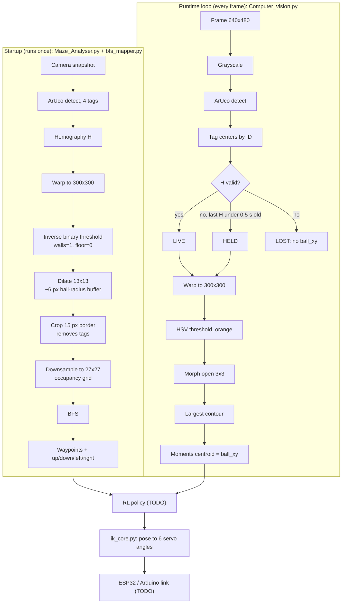

# Stewart Platform Maze Solver: Software Report

**Date:** 2026-10-28 | **Scope:** Raspberry Pi vision, maze mapping, path planning, servo IK | **Status:** Code written. Nothing tested on hardware.

## Bottom line

- **Built:** live ball tracking (`Computer_vision.py`), one-shot maze reader (`Maze_Analyser.py`), BFS path planner (`bfs_mapper.py`), servo inverse kinematics (`ik_core.py`), and pinned Pi dependencies (`requirements.txt`).
- **Verified:** BFS returns the shortest path. On a 27x27 test grid it found 52 moves, the theoretical minimum, and returned `(None, None)` when the target was blocked. All 4 modules pass a syntax check.
- **Not verified:** Nothing has run on the Pi, camera, or servos. The dev PC has no OpenCV or NumPy installed.
- **Blocker:** `Maze_Analyser.py` will crash (`NameError`). After that is fixed, it still outputs an all-free grid, so BFS ignores the walls. See defects D1 to D4 in §6.
- **Decision needed:** Servo link. `requirements.txt` assumes Arduino over serial. The latest brief says ESP32 over UDP.

## 1. Problem statement

The RL agent needs three inputs:

1. The ball's (x, y) position in a fixed maze frame, every frame.
2. A shortest path through the maze, computed once at startup.
3. A conversion from platform pose (x, y, z, roll, pitch, yaw) to 6 servo angles.

The camera is fixed and the platform tilts and yaws, so the maze's appearance in the image changes every frame. The vision system has to undo that motion before any position is usable.

## 2. Workflow

## 3. OpenCV features used

| Stage | OpenCV feature | Setting | Purpose |
|---|---|---|---|
| Capture | `VideoCapture` + `CAP_PROP_*` | 640x480, MJPG, 60 FPS requested, buffer size 1 | Fast, low-latency frames. MJPG gets past the USB bandwidth limit of raw YUYV. A 1-frame buffer stops the code from processing stale frames. |
| Tag detection | `aruco.ArucoDetector` (4.7+ API) | `DICT_4X4_50` | Finds tags 1 to 4. 4x4 has the largest cells of the standard dictionaries, so it's the most reliable at low resolution. |
| Tag detection | `CORNER_REFINE_SUBPIX` | On | Sub-pixel corners, so the warp doesn't jitter and add fake ball velocity. |
| Tag centers | NumPy `mean(axis=0)` over 4 corners | Keyed by tag ID | IDs, not image positions, define the sides, so yaw can't swap them. |
| Homography | `getPerspectiveTransform` | 4 tag centers to side midpoints of 300x300 | Exact solve: 8 unknowns from 4 points × 2 equations. |
| Sanity checks | `isContourConvex`, `contourArea(oriented=True)` | Area at least 2000 px², winding sign matches | Rejects twisted (bowtie), collapsed, and mirrored tag layouts before they produce a bad warp. |
| Warp | `warpPerspective` | `INTER_LINEAR`, 300x300 | Flat top-down maze view for both tracking and mapping. |
| Ball color | `cvtColor(BGR2HSV)` + `inRange` | Orange H 5–25, S 120–255, V 120–255 (placeholder) | Hue-based color filter that holds up better under brightness changes than BGR. |
| Ball cleanup | `morphologyEx(MORPH_OPEN)` | 3x3 ellipse | Removes specks and thin glare streaks attached to the ball, which would pull the centroid. |
| Ball blob | `findContours` | `RETR_EXTERNAL`, `CHAIN_APPROX_SIMPLE` | Outer outlines only, so a specular hole in the ball is ignored. |
| Ball filter | `contourArea` | Largest blob, at least 30 px² | Picks the ball and rejects noise when no ball is present. |
| Ball position | `moments` | `m10/m00`, `m01/m00` | Area-weighted centroid with sub-pixel output. Steadier than the enclosing-circle center. |
| Ball radius | `minEnclosingCircle` | Radius only | Used for drawing only. |
| Maze walls | `threshold(THRESH_BINARY_INV)` | Cutoff 127 | Black walls become 1 (obstacle), white floor becomes 0 (free). |
| Wall buffer | `getStructuringElement` + `dilate` | 13x13 ellipse, 1 iteration | Even ~6 px buffer in every direction, so the path keeps the ball's radius off the walls. A repeated 3x3 kernel would give a diamond- or square-shaped buffer instead. |
| Grid | `resize(INTER_AREA)` | 270x270 crop to 27x27 | Averages each 10x10 block into one cell. |
| Debug | `drawDetectedMarkers`, `circle`, `putText`, `imshow`, `waitKey` | `SHOW_DEBUG` toggle | Live view over VNC. Turn it off for real runs to recover FPS. |

## 4. Design decisions

| Decision | Rationale | Evidence |
|---|---|---|
| Capture at 640x480, not 1080p | Detection cost scales with pixel count, and the output is only 300x300 anyway. | 0.31 MP vs 2.07 MP, 6.75x fewer pixels per frame |
| Bind tag ID to physical side | Sorting tags by image position flips the maze under about 45° of yaw. | Geometric. No test needed. |
| `getPerspectiveTransform` over `findHomography` | Exactly 4 points: nothing to average and no outliers to reject. | H has 9 entries, normalized so H[2,2] = 1, leaving 8 unknowns. 4 points × 2 equations = 8. |
| LIVE / HELD / LOST fallback | A tag hidden briefly by a hand or glare shouldn't drop tracking. | Reuses the last good H for at most 0.5 s. |
| Winding-sign check | A mirrored camera or swapped opposite tags would invert left/right tilt with no visible error. | Valid example diamond: +41,427 px². Same diamond mirrored: −41,427 px². Rejected. |
| Removed white-ball tag mask | Orange ball chosen. The black-and-white tags can't pass an orange filter. | Removed `TAG_MASK_RADIUS_PX` and `build_tag_exclusion_mask()` |
| Removed pre-4.7 ArUco fallback | One code path. The version is pinned. | `opencv-contrib-python==4.14.0.94` |
| OpenCV 4.14, not 5.0 | Code targets the 4.x API and hasn't been checked against 5.0. | 4.14 has prebuilt 64-bit ARM wheels on PyPI. |
| NumPy 2.4.6 | 2.5+ requires Python 3.12. Pi OS Bookworm ships 3.11. | PyPI metadata |
| Non-headless OpenCV | Debug windows are viewed over VNC. | `imshow` needs GUI support. |
| No lens calibration (yet) | A homography fixes tilt but can't straighten lens-curved lines. Whether it matters depends on the lens. | **Open.** Check whether the maze walls look straight in the warped view. |

## 5. Data and verification

| Test | Result | Status |
|---|---|---|
| Syntax check: all 4 modules | Pass | ✅ |
| BFS, 27x27 grid, wall at column 5 rows 0–19, (0,0) to (26,26) | 53 cells, 52 moves (minimum possible), every step 1 cell, 1 direction per move | ✅ |
| BFS, target walled in | Returns `(None, None)`, no crash | ✅ |
| `ik_core.py` self-test (expect 90° on all 6 servos at home) | Not run. No NumPy on the dev PC. | ⏳ |
| Loop FPS on Pi, `SHOW_DEBUG` on vs off | Not measured | ⏳ |
| Corner jitter, `SUBPIX` vs `NONE` (std. dev. of a still ball's `ball_xy`) | Not measured | ⏳ |
| HSV bounds under makerspace lighting | Placeholders | ⏳ |

**Estimates, not measured:** MJPG decode at 640x480 takes about 2–5 ms/frame on a Pi 4 and about 1–2 ms on a Pi 5. Sub-pixel refinement takes about 0.1 ms per tag.

## 6. Open defects

### `Maze_Analyser.py` (blocks BFS on the real maze)

| # | Defect | Effect | Fix |
|---|---|---|---|
| D1 | `warped_frame` is never defined | `NameError`. The function crashes at the crop. | Crop `dilated` instead |
| D2 | `np` isn't imported | `NameError` at `np.where` | Add `import numpy as np` |
| D3 | Threshold runs on the color `warped` image, not grayscale | The grid comes out 27x27x3. Each `bfs_list[y][x]` is a 3-item list, never `== 1`, so every cell reads as free. | Run `cvtColor(BGR2GRAY)` on `warped` before thresholding |
| D4 | Threshold max value is `1`, but the grid test is `> 12` | `INTER_AREA` on 0/1 data stays at 0 or 1, never above 12, so every cell reads as free. | Use max value `255`. Then `> 12` means more than about 5% wall, which is the intended rule. |
| D5 | Debug PNGs are saved as 0/1 | Saved images look completely black (debug only) | Fixed by D4, or multiply by 255 when saving |
| D6 | Module-level `cap` is released inside the function | A second call to `Maze_Reader()` fails. The first frame may also be under-exposed. | Open the camera inside the function and discard a few frames before the snapshot |

### `bfs_mapper.py`

| # | Defect | Effect | Fix |
|---|---|---|---|
| D7 | Start `(0,0)` and target `(26,26)` are hard-coded corners | Corners are probably wall after dilation, which returns `(None, None)` | Pass in the ball's cell and the goal cell |
| D8 | Bounds hard-code a 27x27 grid | Breaks if the crop or cell size changes | Use `len(bfs_list) - 1` |

### Integration

- **I1:** The servo link is undecided. `pyserial` (Arduino) is in `requirements.txt`, but the latest brief specifies ESP32 over UDP.
- **I2:** `ik_core.py` dimensions, `SERVO_NEUTRAL_DEG`, and `SERVO_DIRECTION` are placeholders. A wrong direction sign drives a servo the wrong way.
- **I3:** The RL policy hand-off is still a `TODO` in the `Computer_vision.py` main loop.

## 7. Next steps

Due dates are TBD. None were set today.

| # | Action | Owner | Due | Unblocks |
|---|---|---|---|---|
| 1 | Fix D1–D4 in `Maze_Analyser.py`, then check `maze_dilated.png` and the 27x27 grid | Software | TBD | BFS on the real maze |
| 2 | Pass the real start and goal cells into BFS (D7) | Software | TBD | A usable path |
| 3 | Set up the Pi venv, `pip install -r requirements.txt`, and confirm `4.14.0 True` from the version check | Software | TBD | All runtime testing |
| 4 | Run the `ik_core.py` self-test on the Pi | Software | TBD | IK sign-off |
| 5 | Measure the hardware (base and platform radius, horn and rod length, anchor angles) and enter them in `ik_core.py` | Mechanical | TBD | Real servo angles |
| 6 | Verify each servo's neutral and direction one at a time, with tight `POSE_LIMITS` | Mechanical + Software | TBD | Safe first motion |
| 7 | Tune HSV bounds and lock camera auto-exposure and white balance | Software | TBD | Reliable ball tracking |
| 8 | Measure loop FPS with `SHOW_DEBUG` on and off over VNC | Software | TBD | Control-loop timing budget |
| 9 | Check the warped view for lens bowing, and calibrate with a chessboard if needed | Software | TBD | Accurate positions near the maze edges |
| 10 | Decide between ESP32 UDP and Arduino serial (I1) | Lead | TBD | Servo comms code |
| 11 | Wire the RL policy into the main-loop `TODO` (I3) | Software | TBD | End-to-end system |

## Appendix: Files

| File | Purpose | State |
|---|---|---|
| `Software/Computer_vision.py` | Live tracking loop: ArUco, homography, warp, ball centroid | Complete. Not hardware-tested. |
| `Software/Maze_Analyser.py` | One-shot maze snapshot to 27x27 occupancy grid | In progress (D1–D6) |
| `Software/bfs_mapper.py` | BFS shortest path + direction list | Logic verified (D7–D8 open) |
| `Software/ik_core.py` | Pose to 6 servo angles, with `np.clip` to 0–180° | Complete. Placeholder dimensions. |
| `Software/requirements.txt` | `opencv-contrib-python==4.14.0.94`, `numpy==2.4.6`, `pyserial==3.5` | Complete. Comments still say `text.py`. |
